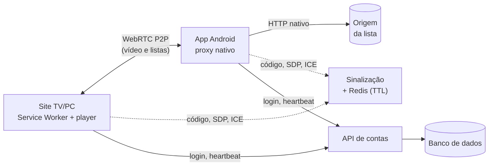
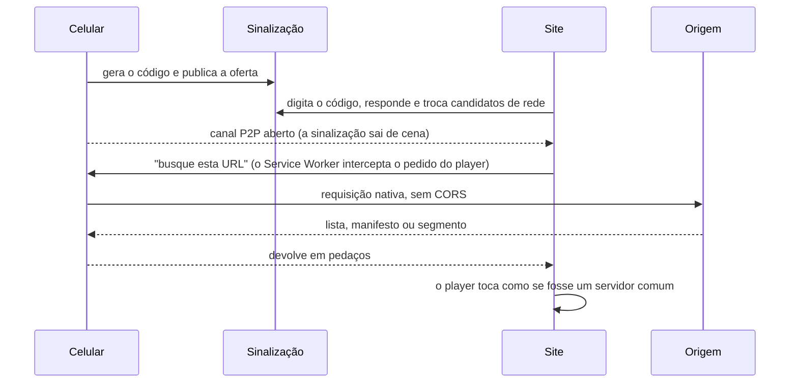

# Dragon IPTV — Como o sistema funciona

> Tudo neste documento é **exemplo**: nenhuma API, banco, chave, token ou lista real. Domínios são `exemplo.invalid` e as contas são `@dragoniptv.example`. Os números (tempos, tamanhos) são valores ilustrativos.

**Veja o exemplo funcionando:** [dragoniptvsite.vercel.app](https://dragoniptvsite.vercel.app/)
Site de demonstração com dados fictícios. Para ver tudo, entre como VIP com `vip@dragoniptv.example` e a senha `vip1234`.

## 1. A ideia

Um navegador não consegue buscar qualquer lista ou vídeo de qualquer lugar (CORS, bloqueios, limites de tempo em servidor). Um app no celular não tem essas travas.

Por isso o **celular faz o papel de proxy** e o **site usa o celular** para buscar o conteúdo. O vídeo vai direto do celular para o site, sem passar por servidor intermediário.

## 2. As peças

| Peça | Faz o quê |
|---|---|
| **App (celular)** | Interface completa + proxy nativo que busca listas e vídeo |
| **Site (TV/PC)** | Mesma interface; depende do celular para buscar conteúdo |
| **Sinalização** (`/api/bridge` + Redis) | Apresenta site e celular um ao outro. Não vê lista nem vídeo |
| **API de contas** | Login, sessão, servidores, favoritos, pedidos |
| **Banco de dados** | Usuários, sessões, servidores, favoritos, pedidos |
| **Origem** | Servidor da lista M3U/HLS (fora do projeto) |

## 3. Celular × site: quando precisa de código

| | Código | Como entra |
|---|---|---|
| **Celular (app)** | **Não precisa** | Abre o app e escolhe qualquer opção: Free, VIP, servidor ou a própria lista M3U |
| **Site (TV/PC)** | **Precisa** | No app toca em *Gerar código*; no site digita os 6 dígitos |

O código serve só para o site **encontrar** o celular. Vale uma vez, para um aparelho, e expira sozinho. Gerar outro invalida o anterior.

## 4. O caminho do vídeo no site (do código ao play)

Explicando cada parte uma única vez:

- **Sinalização:** só troca mensagens pequenas de texto (oferta, resposta e caminhos de rede). Funciona por *polling* a cada ~1 s, porque em serverless não há conexão aberta.
- **Canal P2P (WebRTC):** conexão direta entre os dois aparelhos, cifrada. Se o caminho direto falhar, um servidor TURN repassa os bytes cifrados.
- **Service Worker:** o player pede `/api/stream?url=...`. O Service Worker pega esse pedido e o manda ao celular. Para o player, parece um servidor normal.
- **Manifesto HLS:** antes de chegar ao player, cada linha de segmento é reescrita para voltar pelo mesmo caminho. Assim nenhum segmento vai direto à origem.
- **Filmes:** chegam em blocos de ~2 MB, com uma pequena janela à frente da posição. Pular a barra vai direto ao bloco novo.
- **Transporte:** pedidos são JSON; o conteúdo vai em binário (`[tamanho do id][id][bytes]`), mais leve que base64.

## 5. Conta, sessão e perfis

1. **Login:** a API confere o hash da senha e devolve um **token**. No banco fica só o hash do token.
2. **Heartbeat:** a cada ~2 min o app/site avisa que continua aberto e se está reproduzindo. Sem sinal e sem reprodução, a sessão expira. Se a API responder `401`, o cliente faz logout; falha de rede não desloga.
3. **Perfis:**

| | Anúncios | Servidores | Favoritos |
|---|---|---|---|
| **Free** | Sim | Só os free | Não |
| **VIP** | Não | Free + VIP | Sim |

O servidor decide o que cada perfil pode ver e salvar. O cliente só exibe.

## 6. Banco de dados e Redis

| Onde | O que guarda |
|---|---|
| **Banco (SQL)** | `usuarios`, `sessoes`, `servidores`, `favoritos`, `pedidos`, `comprovantes`, `codigos_login` |
| **Redis / KV** | Código da ponte, oferta, resposta e candidatos de rede. Tudo com **TTL** (~10 min) e some sozinho |

Relações principais: um usuário tem várias sessões, favoritos e pedidos; um pedido tem comprovantes. Apagar o usuário apaga sessões e favoritos (`CASCADE`); os pedidos ficam no histórico.

**Não vai para o banco:** lista M3U, catálogo e vídeo. A lista é lida na hora pelo celular e fica em cache no aparelho.

## 7. Segurança em cinco linhas

1. Senha com bcrypt/argon2; token aleatório, só o hash no banco.
2. Proxy só com destinos permitidos (*allowlist*), nunca aberto a qualquer URL, e com verificação de certificado ligada.
3. Códigos de 6 dígitos com gerador seguro (`crypto.randomInt`), curta duração, uso único e limite de tentativas.
4. CORS restrito ao seu site e nenhuma chave de API no código do app ou do site.
5. Regras de perfil (VIP, servidores) validadas sempre no servidor.
